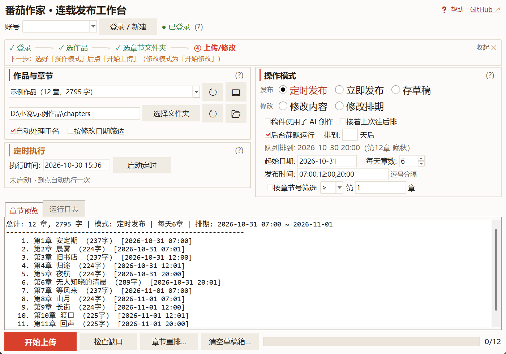

# 番茄作家批量上传工具

> 把本地章节批量发到番茄作家：一次排完几个月的更新，每章都核对是否真的发出去。

[](LICENSE)

[⬇ 下载 ZIP](https://github.com/rockbenben/fanqie-publisher/archive/refs/heads/main.zip) · [📖 快速开始](#快速开始) —— 需自备 Python 3.10+



选好章节文件夹，工具自动解析章节号、清洗 Markdown 格式、按你设定的时间表逐章发布。番茄的章节顺序只认创建顺序，漏发的章**位置**补不回原位（内容还能改写补正，见「章节顺序与缺口」），所以每发一章都会回平台核对，漏了当场停下并给出可直接粘贴的补传章节号。

## 支持范围

| 项目 | 支持情况 |
| ---- | -------- |
| 平台 | 仅番茄小说「作家助手」网页版，其他小说平台不支持 |
| 系统 | Windows / macOS / Linux |
| 运行环境 | Python 3.10+（Linux 另需 `sudo apt install python3-tk`） |
| 章节文件 | `.md` / `.txt`，含子文件夹；本级文件在前，再按文件夹名逐个文件夹，每个文件夹内按文件名自然排序 |
| 章节号识别 | 第X章 / 回 / 节 / 话（中文数字也认）、数字前缀、`chapter-N` |
| 分卷作品 | 支持，可按卷筛选或「合并所有卷」一次操作全部章节 |
| 多账号 | 支持，顶部下拉框一键切换，各账号独立记忆上次选的作品 |

## 能做什么

- **五种模式** — 定时发布 / 立即发布 / 存草稿 / 修改内容 / 修改排期
- **自动排期** — 多时间点（`08:00,12:00,20:00`）均匀分配，同一天内严格保序，临近午夜会整体前移而不乱序
- **接着上次往后排** — 自动接在平台队列末尾之后排：先填满队尾那天剩下的时间点，再逐日往后，且只发平台上还没有的章
- **逐章核对** — 每发一章回平台确认真的存在；整批跑完再拉一次真实章节列表对账
- **两种筛选** — 按章节号（`≤30`、`5-10`、`1,3,5-10`）或按文件修改时间
- **缺口体检** — 一键查全书错位，分三段告诉你「谁能修、还剩多少时间」，并给出对应的修法；顺带查未公开段的**排期顺序**（章排在更早的时刻、两个章占同一时刻）

## 快速开始

三步：

1. 装 [Python 3.10+](https://www.python.org/downloads/)（Windows 安装时勾选 **Add Python to PATH**）
2. **Windows** 双击 `run.bat`；**macOS / Linux** 终端跑 `bash run.sh`
3. 点「登录 / 新建」→ 浏览器里登录番茄账号 → 回界面选作品 → 选章节文件夹 → 开始上传

首次运行会自动装依赖和浏览器内核，之后直接启动。启动脚本每次都会幂等校验内核，缺失或版本不对会自动补装。

Windows 下环境就绪时**不弹命令行窗口**，只出 GUI；需要装东西时才弹安装进度窗口。排查问题用 `run.bat debug` 保留控制台输出，程序异常退出会自动用记事本打开启动日志。

## 使用指南

首次打开会弹**新手引导**；主界面顶部还有一条引导栏，按「登录 → 选作品 → 选章节文件夹 → 上传/修改」实时高亮当前步骤。引导栏那一行**右边有一颗能点的「下一步」按钮**，会跟着进度变成当前该做的那一步（登录 / 新建 → 刷新作品列表 → 选择文件夹 → 开始上传），点它就是做这一步，不必自己在界面里找是哪颗按钮。引导栏可收起（矮屏会自动收起），收起后那颗按钮仍在细条右端。各区块旁的 `(?)` 有单独说明，随时点「❓帮助」重看新手引导。

### 登录

点「登录 / 新建」，填一个**本地账号名称**（如 `作家A`，只用来区分多个账号，不是番茄笔名），浏览器自动打开登录页，主窗口最小化避让，右下角出现浮动提示窗。

> ⚠️ 登录完成后请先点绿色的「登录完成，保存会话」**再**关浏览器。先关浏览器会导致会话读不到，工具会明确报错要求重新登录，不会把旧账号的会话错存到新名字下。

登录期间上传、刷新作品、切换账号、定时触发都会暂避，等登录结束再继续——避免两个浏览器同时读写登录状态。

### 界面怎么用

窗口分四块：**顶部一条「新手引导」**（四步流程 + 可点的「下一步」按钮）、**中间设置区**（左边「作品与章节」「定时执行」，右边「操作模式」）、**下面一块选项卡**（「章节预览 / 运行日志」）、**最下面的行动条**。

**最底下的行动条**左边那颗红底的是**主行动**——「开始上传」，任务跑起来后变成「停止」。一条竖线之后是四个**出问题时才用**的工具，日常发布不用碰：

| 按钮 | 干什么 | 什么时候用 |
| ---- | ------ | ---------- |
| **检查缺口** | 只读体检（不改任何东西）：把每章的「位置」和「章号」对一遍 | 发完一批想确认顺序没乱；或读者说章节顺序不对 |
| **修复排期…** | 只改**什么时候发**，位置/章号/正文都不动 | 章节本身没写错，只是发布的先后时刻排串了 |
| **章节重排…** | 让位置 *i* 重新装第 *i* 章的内容 | 中间漏发过章，后面的章全串位了（这种情况改排期救不回来） |
| **清空草稿箱…** | 清平台草稿箱 | 存草稿模式攒了一堆不要的草稿 |

每颗按钮的悬停提示第一句都写着「什么时候用：」，不知道点哪个就先悬停看一眼。用法是**先查后修**：先点「检查缺口」，报告里会直接写明该用后面哪一个、改哪一段、位置区间在哪——别自己猜要修哪一段。

### 五种模式

| 模式 | 做什么 | 需要本地文件 |
| ---- | ------ | :----------: |
| **定时发布** | 按起始日期、每天章数、发布时间自动排期 | 是 |
| **立即发布** | 上传后直接发布 | 是 |
| **存草稿** | 上传后存草稿，之后手动逐章发布 | 是 |
| **修改内容** | 按章节号匹配已有章节替换正文，不动发布时间 | 是 |
| **修改排期** | 批量改平台上「待发布」章节的日期/时间，不动正文 | 否 |

前三种是**新建**章节，后两种是**改写**已有章节——失败策略因此完全不同，见[各模式的失败策略](#各模式的失败策略不一样)。

定时发布、立即发布、修改内容可勾「稿件使用了AI创作」，对应番茄的 AI 申报选项，请如实勾选。

### 排期怎么算

- 手填起始日期时，自动建议为「队列排到哪天」的次日（**所有还没公开的章都算**——待发布、审核中、审核不通过都占着未来的坑位，不只是待发布）；勾了「接着上次往后排」这一栏就不用管。修改排期模式下建议的是「最后一章已发布」的次日——待发布章正是要挪的，不能接在它们后面
- 每天章数大于时间点数时，章节均匀分配到各时段，同时段内按 +1 分钟递增
- **同一天内严格按章节顺序递增**：`23:58` 排 3 章会整体前移到 `23:57/23:58/23:59`，不会后面的章反而先发
- 勾「接着上次往后排」则不用自己填起始日期、也不用挑章节：工具去平台看已经排到哪一刻，先填满队尾那天剩下的时间点、再逐日往后排（新章一定晚于队尾，章节顺序 = 发布顺序），且**只发平台上还没有的章**（本地已发过的自动跳过）。旁边「排到 N 天后」留空 = 全排上去，填 N = 只排到那天为止。预览面板会直接列出实际要发的章和日期

> **例：** 每天 6 章、时间 `07:00,12:00,20:00` → `07:00, 07:01, 12:00, 12:01, 20:00, 20:01`

#### 「队列排到」那一行里的两个数

界面上「队列排到」那行有两个数，不是同一个东西，别混：

| | 是什么 | 用来干嘛 |
| -- | ------ | -------- |
| **时间** | 队尾时刻 = 所有**还没公开**的章里最晚的那个发布时刻 | 新章必须排在它后面 → 决定「起始日期」建议哪天 |
| **章号** | 末章 = 位置最后那章（读者最后看到的那章） | 让你一眼看出书排到第几章了 |

健康的书上两者重合。排期错乱的书上不重合——2026-10-31 实测一部 5196 章的书：末章第5196章排在 2028-06-30 20:00，第5191章却排在 2028-09-06 07:00。这时标签会**多报一行 ⚠**，把「末章排在几点、比队尾早多少」和修法说清楚，不拿其中一个冒充另一个。

#### 排期顺序：发布顺序必须 = 目录顺序

**位置顺序 = 目录顺序 = 读者看到的顺序**，所以发布时刻必须跟着位置一起走。工具在两条路上都设了闸：

- **定时发布**手填的起始日期早于队尾 → 直接拦下并告诉你该填哪天（队尾次日）。新章只能追加到全书末尾，排在已排好的章前面，读者就会先看到它。
- **修改排期**改完之后会让发布顺序倒过来 → 拦下并列出是哪一章跟哪一章撞了/反了。

自动接续（「接着上次往后排」）本身就是按队尾算的，不会排错。

### 筛选

**按章节号**（所有模式都有）支持三种写法：单个数字 `30` 配合 `≤`/`≥` 做阈值；范围 `5-10`；逗号组合 `1,3,5-10`。用范围或组合时运算符自动置灰。被跳过的章在预览底部汇总（如 `[跳过 3 章: 3 筛选]`）。

**按修改日期**勾选后可选「早于」/「晚于」某时间点（「晚于」含边界，「早于」不含），格式 `YYYY-MM-DD HH:MM` 或 `YYYY-MM-DD`。格式错会红字拦下，不会静默忽略。

两种筛选的命令行等价物 `--chapters` / `--modified-after` / `--modified-before` 与界面**共用同一个解析器**——失败汇总给的章节号在两个入口粘贴效果完全一样。

### 跑起来之后

界面下方选项卡切「章节预览」和「运行日志」。点「开始上传」后自动切到日志页，所有控件锁定，点「停止」可随时中断。

> 中断请用「停止」。直接关浏览器也会停下并照常给汇总，尚未处理的章节一并记入清单（含可直接补传的章节号），不会被静默漏掉，只是在途那一章可能处于中间状态。

**批次结束会自动对账**：拉平台真实章节列表，核对每个「日志记成功」的章是否真的存在，对不上的报「⚠ 对账发现 N 章日志记成功但平台上没有」并计入补传清单。存草稿模式改用草稿箱接口对账（草稿不进章节管理页，比不了那张表），能直接列出被覆盖丢失的是哪几章。

### 定时执行

填执行时间（`YYYY-MM-DD HH:MM`）点「启动定时」，到点自动执行当前所选模式，仅触发一次。启动前会检查登录状态、有没有选作品、有没有可操作章节。到点时若已有任务在跑会等它空闲，不丢弃本次定时；触发前约 60 秒会自动刷新一次章节目录。定时期间请保持程序运行。

## 章节顺序与缺口

番茄的章节顺序有一条**反直觉但必须知道**的规则（2026-08-20 实测确认）：

> **目录顺序 = 章节在卷内的位置（创建追加顺序），不是标题里的「第N章」，也不是发布时间。**

平台的章节接口里根本没有「章节号」这个字段——编辑器里「第 __ 章」填的值只是拼进标题字符串。所以**新建的章一律追加到全书末尾**，网页端没有任何插入、排序、拖拽入口。

后果是：**中途漏发的章补不回原位**。你把第 709 章补上去，哪怕定时到它原本该发的时刻，它也会排在全书最后，读者看到的是「第 708 章 → 第 710 章 →（全书末尾）第 709 章」。

**位置**只有一条移动途径：在**手机 App** 里「申请调整 → 审批通过 → 单章选中 → 移动位置」，且**只对发布 3 天内的章有效**。

超期之后位置就永远动不了了，但**内容仍然改得动**（网页端的「编辑」按钮对已发布章照常渲染，可编辑与否平台只看一个 `cant_modify_reason` 字段，跟已发布无关）。所以「章节重排」加 `--include-published`（GUI 里选『已公开段』）能把整段错位改写回来：让位置 *i* 重新装第 *i* 章的内容。代价是线上内容要重写并重新过审，读者可能收到更新。

如果这段位置首尾相接成**闭环**（位置互相占着章号，如 480 装 481、481 装 482……最后又装回 480），纯顺序改写永远解不开——先写谁都会撞重名。工具默认**自动用真实正文解开**（也可以加 `--no-buffer` 改成整环跳过并报告）：先把一份章号还没被平台占用的正文写到环上某个位置腾出章号，环转完再把正确章节写回原位。缓冲必须用**平台上还不存在的真实正文**：本地高于平台末尾的未发布章节（自动，一个闭环一份，会提前露出该章正文）或指定一个真实文本文件（不剧透）。合成的「调整中」提示不能用——2026-10-30 实测会被平台按内容安全规范驳回（本章打卡字数清零）。

因此工具的策略是尽早发现、能自动修的自动修。点主界面「**检查缺口**」出体检报告（只读，不改任何东西）：

| 段 | 判据 | 谁来修 |
| -- | ---- | ------ |
| **A** | 未公开（待发布）、位置与章号不符 | 工具自动改写内容，排期不变 |
| **B** | 已公开、位置与章号不符、发布在 3 天内 | 最省事是你去手机 App 移动位置；工具列出章号和**剩余窗口小时数** |
| **C** | 已公开、位置与章号不符、超过 3 天 | App 移动窗口已关，但工具仍能改写内容修整段；报告给出实际要改的章数、位置区间和命令 |

三段都能修，只是成本不同：App 移动只动一章的位置（内容不用重写），改写内容能把整段错位一次修好，但要重新过审。

**没查出错位时**，报告只给一句「✓ 没查出问题：位置与章号全部对得上，不需要修。」——不会摆出三段零值让你自己判断「0 是不是好消息」。命令行 `audit` 与图形界面说同一句话。

体检报告里还有一段**「审核状态」**：全书有几章正在审核（平台在审，现在动不了，等审完再跑一次就能改）、有几章被平台驳回（其中改得动的重排会一并写回，改不动的要去番茄后台改）。原来的「卡队列」告警是其中最严重的一种，会单独用醒目分隔线拍在最前面。

体检报告里还有一段**「排期顺序」**：未公开段里有几章排在比它前面那章**更早**的时刻（读者会先看到它们，目录顺序是乱的）、有几个发布时刻被两章以上占用（平台只能挑一个先发，另一个会被推迟）。这跟「位置与章号不符」是两回事——**位置全对、时刻全乱**，位置体检一个都看不出来（2026-10-31 实测：第5192~5196章排在 2028-06-30，而第5191章排在 2028-09-06；同一批时刻还被第4783~4787章占了一遍）。这种错位工具改不了位置（3 天移动窗口早过了），只能用「修改排期」把那几章的时刻改到队尾之后。

**一键修复**：底部的「**修复排期…**」按钮会自己算出方案——把「排在别人前面」的那几章（连带它们后面要跟着走的整段）挪到队尾之后，给你列出来确认后才真改。**只改发布时间**，位置、章号、正文都不动，所以读者不会收到内容更新，也不用重新过审。命令行等价写法：

```
python fanqie_upload.py reschedule --book-id <ID> --fix-schedule --per-day 6 --time 07:00,12:00,20:00
```

> **报告里「位置与章号不符」才是要动的那一批。** 读者目录里的顺序断点会另外单独一行说明（断在哪个位置、后面多少章被隔断）——被隔断的那些章**位置往往是对的**，只是被前面某一章隔开了顺序（实测：位置 480 卡着第5290章，它后面 640 章的位置全对，可读者读到第5290章之后接着是第481章）。这些章既不用改写、也不用去 App 移动，重排时会被自动跳过。

**章节的五种状态**（工具按这个决定能不能改）：

| 状态 | 含义 | 工具能改吗 |
| ---- | ---- | :---------: |
| `1` | 已发布 | 位置不能；内容可以（`remap --include-published`） |
| `10` | 待发布（已排期） | 能，排期不变 |
| `4` | 审核中 | 不能，等审完 |
| `5` | 已发布章的修改审核中 | 不能，等审完；旧标题/正文仍在线上 |
| `7` | 审核不通过 | 能（平台没给「不可修改」理由时），用「修改内容」/重排重发 |

状态 4/5/7 平台没有公开文档，是从行为反推的：状态 4 的平台原话是「审核中暂不支持修改」；状态 5 是改已发布章后的审核态（2026-10-30 实测：标题/正文还是旧的，审核驳回后才换成新内容、状态变 7）；状态 7 的含义由「它后面紧跟着一大片状态 4」推出来。所以体检报告判的是**模式**（一章异常 + 后面一大片审核中），不是硬编码某个码的意思。

状态 4 和 7 的章**同样占着未来的发布坑位**（只是还没放行），所以算队尾时一并算进去——漏算过一次（2026-10-10）：队尾因此算短，新章被排进了这些章已占的时刻，读者看到的目录顺序直接乱了。状态 5 是已发布章的修改在审，章子本身早就公开了，不占坑位。

状态 7 和状态 4 不一样，值得单独说：平台在状态 7 的那一章**不给「暂不支持修改」的理由**，编辑器进得去（页面写着「审核不通过，请在右侧面板查看原因，修改后再提交」）。工具的判据是**两个条件都满足**才让改：平台没给「不可修改」的理由，且这一章不是审核中（状态 5）——正在审的章不去碰（改内容要重过审，读者会收到更新）。所以审核不通过的章恰恰是解开审核卡队列、以及把被驳回的章节收尾的唯一能动的地方。用「修改内容」模式指定它的章号就能改（改完重新提交）；`remap` 也会把这类章一并写回。也可以去番茄后台手动改那一章。没见过的状态码一律不给编辑入口：不知道平台会拿它做什么，就别去动它。

**多卷作品：** 章节列表接口一次只返回一卷，`index` 是 `卷序号×10000 + 卷内位置`（实测：卷1 `1~100`、卷2 `10001~10150`、卷3 `20001~20115`）。工具遍历每一卷合并成全书视图，位置按全书连续换算——所以对账覆盖全书，不会把别卷的章误判成「平台上没有」。

### 各模式的失败策略不一样

判据是**失败可不可逆**：

| 模式 | 动作 | 漏一章的后果 | 策略 |
| ---- | ---- | ---- | ---- |
| 定时发布 / 立即发布 | 新建章节 | **位置层面的永久缺口**（补上去只会吊在书尾；内容层面可用 `remap --include-published` 修整段） | 逐章确认新章真落地；确认不到或提交失败 → **中止整批** |
| 存草稿 | 新建草稿 | 草稿丢失，不影响正文顺序 | 连续 3 章不明失败才熔断 |
| 修改内容 / 修改排期 | 改已有章节 | 内容/排期还是旧的，重来即可 | 单章失败记入清单、继续；重名冲突留待批末二次尝试 |

新建类中止后不必慌：**停在队尾是无害的**，按汇总给的补传章节号接着发即可。真正危险的是「跳过失败那章继续发」——那会把缺口永久卡在中段。

**未公开段怎么修：** 让位置 *i* 的章装第 *i* 章的内容。原来的中段缺口会变成「队列末尾少排了 N 章」，之后正常上传接着往后排即可——洞不是补上的，是被推到队尾消失的。底部的「章节重排…」按钮默认只动「待发布」的章（对话框里可选择连已公开段一起改）、跳过 60 分钟内就要发的、按章号依赖顺序处理（位置 *i* 要的章号腾出来了才写它），中途停在哪都是「已写的一定在依赖前」，不会乱序或重复。

**已公开段怎么修：** 点「检查缺口」看 C 段——报告会告诉你实际要改多少章、位置区间在哪。在「章节重排…」里选『已公开段』，点「填入 <区间>」即可；对话框顶部会直接显示上次的体检结论。**先查缺口，再点重排，区间让工具替你填**，别自己猜——位置是全书位置，不是章号，填错了表现是"什么都没改"，很难看出原因。命令行等价写法：

```
python fanqie_upload.py remap --include-published --range 480-694       # 预览
python fanqie_upload.py remap --include-published --range 480-694 --run
```

预览里如果报「闭环」，那就是位置互相占着章号（位置 670 装第673章、位置 673 装第676章……最后一个又装回第670章），按现有顺序写进去就是死锁：先写谁都会撞重名。**默认会自动用真实正文解开它**——先把一份章号还没被平台占用的正文写到环上某个位置腾出章号，环转完再把正确章节写回原位；GUI 里在「章节重排…」对话框的「闭环处理」里可以改：

```
python fanqie_upload.py remap --include-published --range 480-694 --run                    # 默认：自动用本地未发布章解
python fanqie_upload.py remap --include-published --range 480-694 --no-buffer --run        # 不解：闭环整环跳过并报出来
python fanqie_upload.py remap --include-published --range 480-694 --buffer-file buffer.md --run  # 用自己写的真实场景解（不剧透）
```

缓冲必须是**平台上还不存在的真实正文**（合成提示会被内容安全驳回）。自动模式从平台末尾之后的未发布章里按章号从小到大取（一个闭环一份，章号不能重复——重复就是重名）；中段缺号不能拿来当缓冲（可能只是标题错位，正文仍在平台上，会撞重名）。**代价**：换位期间（等平台过审，可能几分钟到几小时），被借用的那个位置的读者会短暂看到这份正文，最后会写回正确章节、缓冲章仍留在本地。不想接受这个代价就加 `--no-buffer`（无人值守的 `--daily` 默认也不自动解——没人盯着的时候不该替作者做这个决定）。

已发布章的修改都要等平台审核：每一章提交后要等它真正生效再写下一章，审核没跑完本次会暂停，等审完重跑继续。

**跑完的汇总会说清楚哪些动了、哪些没动**：`成功 23  失败 0  没动 9` ——「没动」的那些是闭环，报告会点名是哪几个位置、现在各装的是什么、读者目录里会看到什么，以及下次跑会自动解开（除非加了 `--no-buffer`）。只写「成功 23 失败 0」会让人以为全改完了，而读者目录里那 9 章其实还是错的。

**重排跑到一半，屏幕上会一直动：** 写入阶段每章吐一行进度（`[12/85] index 490: …`），带**已用时间**和**预计还需**；单章要开编辑器、清空旧稿、灌正文、等平台保存，这一段可能一分多钟一个字都不吐——这中间工具会报「⏳ 位置 490 改写为第490章 还在进行（已用 45 秒）」，免得你以为程序卡死了。图形界面里这些输出是**实时**滚进「章节预览」面板的，顶上的进度条按章数走（`12/85`）；命令行里直接看终端。整批跑完的汇总会带上写入用时。

### 清空草稿箱

番茄在编辑器里填正文时会自动存草稿，历史上定时发布的假成功 bug 每次都留下一份孤儿草稿（748 章那次漏 151 章，草稿箱同源堆了 241 条）。这些草稿本地都有源文件，可以放心清掉。

底部的「清空草稿箱…」删之前会强制做一次**安全检查**：每条草稿的章号必须在本地目录里有对应文件，有任何一条对不上就拒绝执行（有正文却没有章号的草稿同样拦下）——那说明这份内容只存在于草稿里，删了就没了。

## 已知限制

- **漏发的章补不回原位**（网页端）。位置只有手机 App 能在发布 3 天内申请移动，超期就再也动不了——这也是工具宁可中止整批也不跳章继续的原因。超期不等于没救：`remap --include-published` 能改写内容把整段修回来，代价是线上内容要重写并重新过审。**闭环默认自动用真实正文解开**（本地末尾后的未发布章，一个闭环一份；加 `--no-buffer` 改为整环跳过）；也可通过 `--buffer-file` 指定真实文本文件（不剧透）。已发布章的修改要等审核生效，审不完本次会暂停，等审完重跑继续。
- **发布字数有平台上限，分每日和每月两档。** 撞上后工具立即中止整批（继续提交只会重复撞限），当前章和所有剩余章节记入清单，按章节号补传即可。日志会写明撞的是哪一档——**每日**次日再跑，**每月**得等下月额度重置，「明天再来」不管用。
- **不支持自动断点续传。** 但结束汇总会把未成功的章压成一段章节号（如 `79-114`），粘回「按章节号筛选」就能只补这些。
- **距定时发布不足 30 分钟时提交的修改可能不生效**（平台规则）。即使日志显示「已保存修改」，临近发布时间的章节建议抽查确认。
- **登录必须有头浏览器。** 其余步骤可勾「后台静默运行」，登录这一步要你本人操作，不能无头。
- **多卷作品各自从 1 编号时不要勾「合并所有卷」。** 本地章节号重复时只取首个文件，其余跳过并在日志列出重复号，请按卷分别操作。

## 常见问题

**提交都说成功，但章节列表里后面一大批停在「审核中」不动？** 这是**审核卡队列**，点「检查缺口」会把它单独拎出来报警：

```
⚠ 审核卡住了：位置 4783 这一章没过审核，后面 413 章全卡在审核中（一直排到位置 5196）
   被卡的那章：位置 4783「第4783章 不是挨着的时候」
   怎么办：用「修改内容」模式把这一章改掉重新提交（工具里就能改），或去番茄后台改这一章；改完重新送审，后面这批跟着过
   ⚠ 它不会自己过审：平台按位置顺序审，这一章不解决，后面这 413 章就一直卡着不发布
```

平台按位置顺序审：某一章没过，后面所有提交都停在「审核中」。**放一放不会自己好**，得先把那一章改掉。工具改不了平台侧的审核结论，只能告诉你卡在哪。

---

**点「登录 / 新建」、填了名称后没反应？** 最常见是**浏览器内核（chromium）没装上**——`playwright` 这个 Python 包和它驱动的 chromium 是两个独立部分。启动脚本会幂等校验并自动补装（校验的方式是**真启动一次无头浏览器**，这样不管 Playwright 把内核拆成几个产物都验得到）；万一仍缺，界面会弹窗提示「缺少浏览器内核」并可一键下载——不只是登录，任何要开浏览器的操作（刷新作品列表、检查缺口、章节重排…）都会触发这个提示，且一次会话只弹一次。也可手动跑 `python -m playwright install chromium`。

**日志说发成功了，平台上却没有这一章？** 这是最危险的一类故障——曾经一批 748 章的定时发布，日志记「成功 736」，平台实际少了 151 章，三周后才发现，那时早已超过手机 App 的 3 天移动窗口，缺口全部落进了错位段（位置再也动不了，只能靠 `remap --include-published` 改写内容补正）。根因是把「确认发布按钮消失」当成提交成功，而对话框被异常关闭时按钮同样会消失。现在有两道防线：单章要拿到接口 `code=0` 或页面跳回章节管理页才算成功；整批跑完再拉平台真实列表对账。出现「⚠ 对账发现 N 章日志记成功但平台上没有」就用清单里的章节号补传，**越快越好**。

**提示「本书中存在重复标题，请修改后再发布」？** 分三种：**标题搬移的临时冲突**（常见）——本地重新编号把标题从一章挪到另一章，新章先于旧章提交同名标题被拒，上传/修改工具会自动留待批末二次尝试；**重排闭环**——已发布段的位置互相占着章号，纯顺序改写解不开，重排工具默认自动用本地未发布章解开（也可加 `--no-buffer` 整环跳过，或用 `--buffer-file` 指定真实文本文件）；**真正撞名**——与本次批量之外的章节同名，需在平台手动改掉其一再补传。

**任务跑完了，界面却像卡住一样？** 个别情况下浏览器子进程会卡在退出阶段（实测曾长达 41 分钟）。章节其实早已提交成功，只是收尾被拖住。工具已对关闭浏览器、保存登录状态、Playwright 驱动退出这些收尾步骤加了超时保护，关不掉就放弃等待，汇总立即给出。日志出现「关闭浏览器超过 N 秒未完成」或「Playwright 收尾超过 N 秒」属于此情况，不影响结果。

**上传失败怎么排查？** 按顺序看：① 结束汇总里的「失败章节及原因」清单；② 日志里的 `页面提示: `（失败瞬间捕获的平台弹窗原文，超时类还附页面 URL 和按钮状态）；③ 项目目录下的错误截图（上传失败如 `error_0_chapter-039.png`，作品列表抓不到如 `error_booklist_empty_<时间戳>.png`）；④ `fanqie_error.log` 全过程日志。如果 `页面提示` 里出现了工具不认识的失败文案，欢迎反馈以便补充识别词库。

**登录状态过期 / 想换账号？** 点「登录 / 新建」输入对应账号名重新登录，会问是否覆盖旧状态。登录状态分别存在 `.auth_账号名.json`。状态文件损坏（如进程被强杀留下半截文件）时工具自动忽略并提示重登，不会启动失败。

## MD 文件格式

每个 MD 或 TXT 文件对应一个章节：

```markdown
# 第 39 章 安定期

一周后。

周六下午两点。
```

**首行**的 `# 标题` 用于提取章节号和标题；首行不是 `# 标题` 时从文件名提取。正文中部出现的 `# ` 行按正文处理（只去掉 `#` 记号、保留文字），不会截断内容。正文里的 Markdown 标记会自动去除（加粗、斜体、标题、引用、列表、代码块、HTML 标签等），但颜文字 `(>_<)`、比较符号 `体温>38` 不会被误删。

**排序**：本级文件排在前面，然后按文件夹名逐个文件夹、每个文件夹内按文件名自然排序，文件名里的数字（阿拉伯数字和中文数字都算）按数值比大小——`第一章 < 第二章 < … < 第九章 < 第十章 < 第十一章`，`第1章`、`001_`、`chapter-1` 同理。**上传顺序 = 番茄的目录顺序**，所以这一条直接决定读者看到的章节顺序（见「章节顺序与缺口」）。没有章号的文件（番外/设定之类）也会被当成一章发布，预览里会标成「无章号」并给出提示，用「按章节号筛选」可以排除。

一个例外：**以中文数字开头**的文件名（`一.md`、`十二.md`）按字符排，不按数值——中文数字只在带前缀时（`第X章`）才按数值比。这是为了不悄悄改掉已有文件的先后：文件顺序就是章节位置，3 天后移不回来。数字相同但写法不同的几个文件（如 `1.md` 与 `01.md`）按文件名本身分先后，不会看文件系统怎么枚举。

| 文件名格式 | 示例 | 章节号 | 标题 |
| ---- | ---- | :----: | ---- |
| 数字前缀 | `001_新的旅程.md` | 1 | 新的旅程 |
| 数字+冒号 | `001：新的旅程.md` | 1 | 新的旅程 |
| 第X章（数字） | `第27章_重新开始.md` | 27 | 重新开始 |
| 第X章（中文） | `第十六章 发布会.txt` | 16 | 发布会 |
| 第X回 | `第二十七回 黛玉葬花.md` | 27 | 黛玉葬花 |
| 第X话/节 | `第16话 出发.md` | 16 | 出发 |
| chapter-N | `chapter-039.md` | 39 | _(从文件内 `#` 标题提取)_ |
| 纯文字 | `安定期.md` | _(无)_ | 安定期 |

## 命令行用法

> 🛠️ **进阶** —— 只用图形界面的话可以跳过整节。GUI 里的每项功能命令行都有对应入口，两边参数一一对齐。想改代码或跑测试见 [CONTRIBUTING.md](CONTRIBUTING.md)。

```bash
python fanqie_upload.py login                 # 登录并保存会话
python fanqie_upload.py books                 # 列出你的作品及 Book ID

# 上传（默认仅存草稿）
python fanqie_upload.py upload ./chapters --book-id <ID>

# 定时发布：从 9-01 起每天 2 章，三个时间点（日期换成你自己的）
python fanqie_upload.py upload ./chapters --book-id <ID> \
  --schedule 2026-09-01 --per-day 2 --time 08:00,12:00,20:00

python fanqie_upload.py upload ./chapters --book-id <ID> --publish   # 立即发布
python fanqie_upload.py upload ./chapters --book-id <ID> --edit      # 修改已有章节内容

# 补传：把上次失败汇总给的章节号原样粘进来
python fanqie_upload.py upload ./chapters --book-id <ID> --chapters 79-114

# 自动接续：从平台队列末尾往后排，只补到今天+7 天
python fanqie_upload.py upload ./chapters --book-id <ID> --auto-continue --days-ahead 7

# 批量改排期：所有「待发布」章节从 9-01 起每天 6 章（加 --all-volumes 合并多卷）
python fanqie_upload.py reschedule --book-id <ID> --schedule 2026-09-01 --per-day 6

python fanqie_upload.py audit                 # 缺口体检（只读）
python fanqie_upload.py audit --daily         # 无人值守体检，发现问题弹窗
python fanqie_upload.py remap                 # 预览重排计划（只读）
python fanqie_upload.py remap --run           # 真的改写

# 修已公开段的顺序错位（会重写线上内容，先看预览）
python fanqie_upload.py remap --include-published --range 480-694
python fanqie_upload.py clean-drafts          # 草稿箱预览 + 安全检查
python fanqie_upload.py clean-drafts --run    # 真的删
```

`remap` / `clean-drafts` **默认只预览**，加 `--run` 才真写。`remap` 另有 `--include-published`（**连已发布的章一起改**，用于修已公开段的顺序错位；不改它就只动未公开章）、`--only N`（灰度改一个）、`--range A-B`、`--limit N`、`--safety-minutes N`（跳过 N 分钟内就要发布的章，默认 60）。闭环**默认自动用真实正文解开**（本地末尾后的未发布章，一个闭环一份）；`--no-buffer` 改成不解、整环跳过并报出来，`--buffer-chapter N|auto` 指定用哪一章，`--buffer-file PATH` 用自己写的真实文本文件（不剧透）。`clean-drafts` 的 `--force` 可跳过安全检查强删，**草稿删掉没有回收站**，只在确认那些本地找不到源文件的草稿确实不要了再用。

`--book-id` 默认取 `.gui_state.json`，`--content-dir` 默认取 `config.json`；`--headless` / `--show-browser` 覆盖配置里的无头设置。完整参数见 `python fanqie_upload.py -h`。

> ⚠️ **挂成定时任务时强烈建议显式传 `--book-id` 和 `--content-dir`。** 不传时它们取「上次在 GUI 里选的作品」和配置里的章节目录——**你在 GUI 里切一次作品，今晚的定时任务就换了目标**。工具在真写入前会做一次归属校验（拿平台已发布章的标题跟本地同章号文件比对），对不上就中止且不做任何改动；但显式指定才是根治。
>
> Windows 计划任务用 `pythonw.exe "<仓库>\fanqie_upload.py" audit --daily`（`pythonw` 无控制台窗口）；macOS / Linux 用 `crontab -e` 加 `10 0 * * * cd <仓库> && python3 fanqie_upload.py audit --daily`。

## 配置文件

`config.json` 首次运行自动生成，GUI 会把部分设置写回：

| 字段 | 说明 | 默认值 |
| ---- | ---- | ------ |
| `delay_between_chapters` | 章节间等待秒数 | `3` |
| `headless` | 后台静默运行（GUI 同名勾选框写回） | `false` |
| `max_retries` | 单章失败最大重试次数 | `2` |
| `default_mode` | 默认模式（`schedule`/`publish`/`draft`/`edit`/`reschedule`） | `schedule` |
| `default_per_day` | 默认每天章数 | `2` |
| `default_time` | 默认发布时间，多个用逗号分隔（支持 `8:00` 简写） | `08:00` |
| `browser_timeout` | 浏览器操作超时（毫秒，最小 1000；更小的值视为误填秒数并回退默认） | `15000` |
| `chapters_dir` | 章节文件夹路径 | `chapters/` |
| `auto_continue` | 定时发布是否自动接续平台队列 | `false` |
| `days_ahead` | 自动接续只补到「今天 + N 天」；`null` = 全排上 | `null` |
| `auto_unique` | 是否自动处理重名章节 | `true` |
| `use_ai` | 是否申报「使用 AI 创作」 | `false` |

GUI 还会往这里写几个纯界面状态（`timer_time`、`resched_filter_*`）用于恢复上次的选择，不需要手工编辑。
